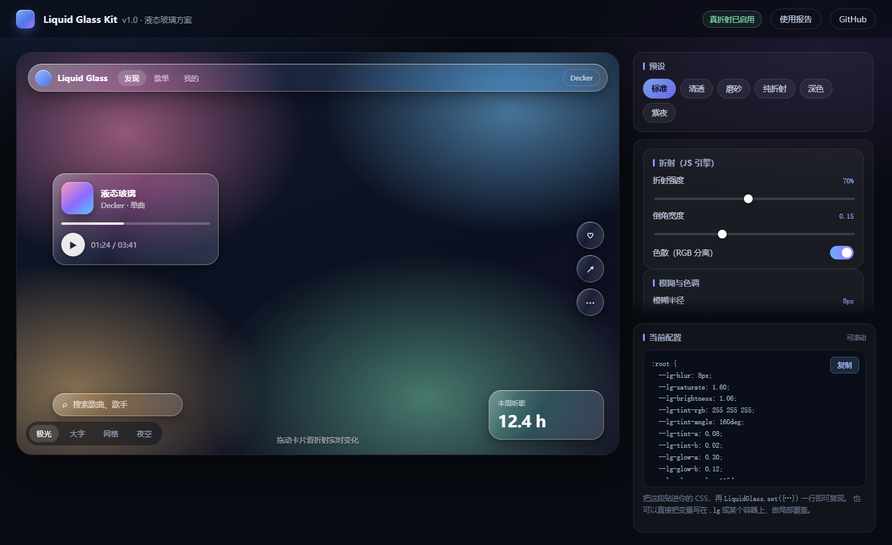

# Liquid Glass Kit

> 一套可以直接拿去用的**液态玻璃（Liquid Glass）**方案：CSS 变量控制外观，JS 引擎负责真折射，
> 附带一个可视化调参台 —— 拖完滑块，复制一段 CSS 就能落地。



不是「半透明白 + 高斯模糊」那种假玻璃。这里有真实的**边缘折射**：

- **SDF 位移图**：圆角矩形有向距离场 → 沿法线向内采样 → 位移在倒角带内呈钟形分布，玻璃内部完全不变形，只有边缘一圈被掰弯
- **SVG `feDisplacementMap`**：R/G 通道当位移向量，R/G/B 三路用不同倍率位移做出极细色散
- **`backdrop-filter: url(#id)`**：作用在元素**背后**的实时画面上，拖动时逐帧更新
- **按尺寸缓存**：同尺寸的 20 个按钮只生成 1 张位移图 + 1 个滤镜，不是每个元素一套

不支持折射的浏览器（Safari / Firefox / iOS）会**自动降级为纯模糊玻璃**，不需要你写任何兜底代码。

---

## 快速开始

```html
<link rel="stylesheet" href="css/liquid-glass.css">

<div class="lg lg-card">任意内容</div>

<script src="js/liquid-glass.js"></script>
```

JS 加载后自动扫描所有 `.lg` 元素并挂载折射，**不需要写初始化代码**。
只要模糊玻璃、不要折射的话，不引 JS 就行。

## 先调参数

打开 [`index.html`](index.html) 的调参台：左侧实时预览，右侧拖滑块，底部「复制」拿到：

```css
:root {
  --lg-blur: 8px;
  --lg-saturate: 1.6;
  --lg-brightness: 1.06;
  --lg-tint-rgb: 255 255 255;
  --lg-tint-a: 0.08;
  ...
}
```

```js
LiquidGlass.set({ refract: 70, bezel: 0.15, dispersion: true });
```

## 参数一览

外观全部走 CSS 变量，可以在 `:root`、某个容器、或元素自身覆盖（就近优先）。

| 变量 | 含义 | 默认 |
| --- | --- | --- |
| `--lg-radius` | 圆角 | `20px` |
| `--lg-blur` | 背景模糊，`0` = 纯折射 | `8px` |
| `--lg-saturate` | 饱和度 | `1.6` |
| `--lg-brightness` | 亮度 | `1.06` |
| `--lg-tint-rgb` | 玻璃染色（空格分隔 RGB） | `255 255 255` |
| `--lg-tint-a` / `--lg-tint-b` | 染色渐变两端透明度 | `.08` / `.02` |
| `--lg-glow-a` / `--lg-glow-b` | 斜向扫光强度（玻璃的「折面」） | `.30` / `.12` |
| `--lg-ring` | 最外 1px 描边 | `.22` |
| `--lg-edge-top` / `--lg-edge-bottom` / `--lg-edge-side` | 四边厚度高光 | `.85` / `.30` / `.30` |
| `--lg-shadow` | 投影 | 两层柔影 |

引擎参数（JS）：

| 参数 | 含义 | 默认 |
| --- | --- | --- |
| `refract` | 折射强度 %，峰值位移 = `refract% × min(20, 短边×0.12)` | `70` |
| `bezel` | 倒角带宽占短边比例（玻璃有多厚） | `0.15` |
| `dispersion` | 是否开启色散 | `true` |
| `enabled` | 总开关 | `true` |

## 变体

| 类名 | 用途 |
| --- | --- |
| `.lg` | 标准玻璃 |
| `.lg--clear` | 浮在照片/封面上的控件（更透） |
| `.lg--frost` | 文字多的界面（更糊、更实） |
| `.lg--thin` | 只折射不模糊，最「玻璃」 |
| `.lg--dark` | 暗色导航/工具栏 |
| `.lg-card` / `.lg-pill` / `.lg-btn` | 卡片 / 胶囊 / 圆形按钮 |
| `data-lg-light` | 指针跟随高光 |
| `data-lg="off"` | 该元素不参与折射 |

## JS API

```js
LiquidGlass.supported          // 当前浏览器是否支持真折射
LiquidGlass.set({ refract: 90, bezel: 0.2 })
LiquidGlass.refresh(el)        // 手动重建（改尺寸时用，ResizeObserver 已自动处理）
LiquidGlass.mount(el, { light: true })
LiquidGlass.destroy(el)
```

## 兼容性

| 浏览器 | 真折射 | 纯模糊玻璃 |
| --- | :---: | :---: |
| Chrome / Edge 110+ | ✅ | ✅ |
| Safari 15.4+ / iOS | ❌ | ✅ |
| Firefox 103+ | ❌ | ✅ |

WebKit 与 Gecko 不支持在 `backdrop-filter` 里引用 SVG 滤镜 —— 这是平台限制，不是实现问题。
库会自动降级，同时给 `<html>` 加 `.lg-no-refract`，你可以自己接管降级外观。

## 目录

```
liquid-glass/
├── index.html              调参台（实时预览 + 参数面板 + 代码导出）
├── docs.html               使用报告（原理 / 参数 / 集成 / 性能 / 踩坑）
├── css/liquid-glass.css    样式库（全部参数走 CSS 变量）
├── js/liquid-glass.js      折射引擎（SDF 位移图 + SVG 滤镜 + 缓存）
└── preview.png
```

完整的原理拆解、框架集成示例、性能预算和 8 个常见坑，见 **[docs.html](docs.html)**。

## License

MIT
